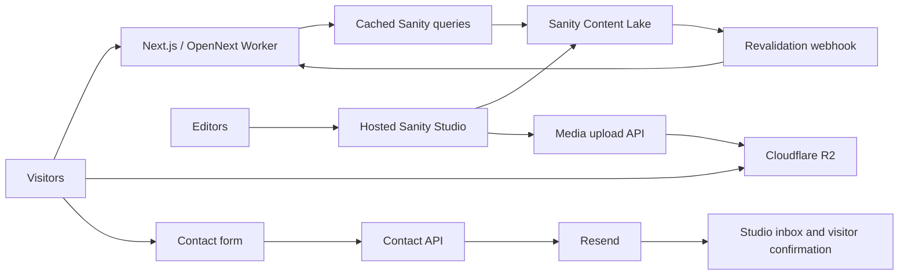

# Kamiyon Studio website: full-stack review and improvement plan

What this repo does: This is Kamiyon Studio's marketing and portfolio website, with Sanity for editorial content, Cloudflare R2 for media, and Resend for contact emails.
Next.js renders the public site through OpenNext on Cloudflare Workers.
The assumed workload is a small studio website with occasional editorial updates and inquiries, not a high-volume application or customer portal.

Reviewed on 11 November 2026 using the local repository and the public production website.
This is a review and proposed backlog; no application fixes, publishing actions, or deployments were performed.

**Recommendation: keep the stack and visual identity, fix the trust boundaries and publishing workflow first, then improve service clarity and motion accessibility.**
The strongest assets are the distinctive scenic identity, real portfolio work, detailed Eclipse case study, centralized theme, and substantial test suite.
The largest gaps are upload authorization, structured-data safety, cache invalidation, contact submission semantics, and the mismatch between what editors can author and what visitors see.

## Method, evidence, and limits

The three requested plugins informed different parts of the review:

| Plugin | Applied approach | Limitation |
| --- | --- | --- |
| Impeccable | Manual audit of visual hierarchy, responsive layouts, accessibility, motion, theme consistency, and implementation integrity | Its context loader and deterministic detector could not run because the engine was unavailable in a writable installation location. The findings below are manual observations and source checks, not detector output. |
| Ponytail | Trace important flows, identify concrete failure cases, rank at most 20 findings, and propose the smallest complete repairs | No speculative rewrite, unused-dependency claims, or invented line-removal savings. |
| pstack | Boundary discipline, root-cause fixes, and the laziness principle | Applied these principles directly. This was not a multi-agent architecture exercise or formal verification run. |

Evidence labels used below:

- **Live:** observed on the deployed website.
- **Source:** verified in repository code or installed dependency behavior.
- **Reproduced:** demonstrated locally with a focused check.
- **Recommendation:** proposed improvement, with benefits not yet measured.

Public browser inspection covered the homepage, About, Services, Game Development service detail, Portfolio, Eclipse case study, Blog, Contact, and the mobile navigation.
Representative viewports were 1440 × 900 and 390 × 844.
I inspected rendered layouts, accessibility-tree content, selected DOM properties, and keyboard behavior.
I did not inspect every project/post/service slug visually, every intermediate breakpoint, or every CMS document.

The repository review traced public routes, shared layout and motion components, CMS schemas/queries/mappers/fallbacks, upload and revalidation handlers, contact validation/delivery, SEO helpers, build settings, and deployment workflows.
Archived content and deliberately retained components were checked against project decisions rather than automatically classified as removable code.

## Architecture and what to retain

The installed stack includes Next.js 16.2.11, React 19.2.4, TypeScript, Tailwind 4, Sanity 5.31.1, OpenNext Cloudflare 1.20.2, and Resend 6.18.1.
Both GSAP and Motion are in use.
Sanity is the content database; R2 is the asset store.
There is no demonstrated need for a separate application database, public authentication, a client dashboard, or microservices.
Adapter-managed cache storage is a different concern from introducing a new business-data database.

Preserve these strengths:

- The Filipino landscape hero and pink, charcoal, and ivory identity make the site recognizable.
- The live portfolio contains real projects: Flappy Awie, Debug.Log, VOCABU Wildlife Edition, and Eclipse.
- Eclipse has substantial material: challenge, solution, gameplay, technical work, impact, lessons, credits, recognition, and gallery.
- CMS schemas, mapping functions, shared metadata helpers, and environment-aware configuration provide useful existing places for repairs.
- Contact validation, header sanitization, a honeypot, and a documented per-isolate limiter already exist.
- Deployment workflows pin GitHub Actions to commits, limit token permissions, and separate staging and production jobs.
- Product/community redirects and the public, noindex Motion Lab are intentional project decisions.
- The test suite is large and mostly passing; improving important behavioral coverage is more valuable than increasing a coverage percentage.

## Verification results

| Check | Observed result | Interpretation |
| --- | --- | --- |
| Locked dependency installation | Completed using `pnpm install --frozen-lockfile` | No lockfile edits were required. |
| Production Next build | Passed with `next build --webpack`; 31 pages prerendered | The application builds. This does not prove the Cloudflare adapter's runtime behavior. |
| Vitest | 194 of 195 files passed; 1,111 of 1,114 tests passed | Three failures are in the hero plate-source tests and reflect a stale depth-2 expectation against the current landscape-only layer configuration. |
| Standalone TypeScript | 36 errors | Mostly test fixtures, mocks, response JSON typing, and environment/type interactions. This is separate from the successful Next build. |
| ESLint | 15 errors and 24 warnings | All 15 errors are in bundled `.agents/skills` CommonJS scripts. Application warnings still deserve focused review. |
| Knip | Completed; no unused-dependency candidates returned | Some output involves bundled skills and intentional exports. No dependency-removal savings are claimed. |
| Playwright | All 21 Chromium smoke tests passed in 2.6 minutes | Initial sandbox startup failed on Wrangler filesystem access; a retry with the required local access passed. These are Node-hosted smoke tests, not live email or Cloudflare publishing tests. |
| Contact partial failure | Reproduced with a stubbed Resend client | Studio email accepted, visitor confirmation rejected, overall submission reported failed. |
| JSON-LD serialization | Reproduced locally | A CMS string containing a closing script tag survives the current `JSON.stringify` serialization. |
| OpenNext defaults | Inspected installed configuration and asserted defaults | Unconfigured tag cache and queue resolve to `dummy`. |
| Live mobile navigation | Reproduced keyboard focus escape | Focus reached the covered Contact page while the overlay remained open. |
| Live metadata | Eclipse had duplicate brand suffix and no `og:image` tag | Canonical URL and single H1 were correct on the same page. |
| Live HTTP headers | Sampled `HEAD /contact` returned 200 | That response did not show CSP, HSTS, `X-Content-Type-Options`, or Referrer-Policy. This is not a complete edge-configuration audit. |

Local logs are in ignored `.cache/review-build.log`, `.cache/review-tests.log`, `.cache/review-types.log`, `.cache/review-lint.log`, `.cache/review-knip.json`, and `.cache/review-e2e-retry.log`.
The local host used Node 25.9.0; deployment CI specifies Node 22.
That difference should be removed before treating local tooling failures as a complete representation of CI.

## Impeccable manual assessment

**Implementation integrity verdict:** the visual identity is coherent and specific to the studio, but production completeness needs work.
Visible placeholder content and editor-to-renderer mismatches undermine an otherwise intentional presentation.

| Dimension | Provisional manual score | Evidence |
| --- | --- | --- |
| Accessibility | 2/4 | Keyboard focus escapes the open menu; persistent motion controls are missing. |
| Performance | Not scored | Source-level opportunities were found, but no reliable Lighthouse, field Core Web Vitals, or throttled-device measurement was completed. |
| Responsive design | 3/4 | Sampled mobile pages and menu were usable, with no horizontal overflow on the checked homepage. Tablet, zoom, and all templates remain unverified. |
| Theming | 3/4 | Central brand tokens and typography are established; component-specific styles and motion conventions need reconciliation. A new dark-mode feature is not required. |
| Implementation integrity | 2/4 | Real case studies and a strong brand coexist with placeholders, metadata defects, and broken content contracts. |
| Total | Not calculated | Adding an invented performance score would make the total misleading. |

These are review judgments, not accessibility certification or an automated benchmark.
The priorities below are 8 P1 findings, 10 P2 findings, and 2 P3 suggestions.
No P0 outage was observed.

## Must fix

### 1. [P1] Replace the browser-exposed shared upload credential

**Evidence:** Source.
Locations: [Studio upload input](O:/Documents/GitHub/kamiyon-studio-website/sanity/components/r2AssetInput.tsx:55), [upload API authorization](O:/Documents/GitHub/kamiyon-studio-website/app/api/media/upload/route.ts:143).

- **What this is:** Studio reads `SANITY_STUDIO_MEDIA_UPLOAD_SECRET`, with a `NEXT_PUBLIC_` alternative, and sends it as a bearer credential to the upload API.
- **Problem:** This places a reusable write credential in browser-delivered code when configured. Studio login does not make bundled environment values secret, as [Sanity explicitly documents](https://www.sanity.io/docs/studio/environment-variables).
- **Fix:** Remove the shared secret from browser builds and authorize uploads using a verified editor identity and scoped, short-lived permission. Until that is ready, an authenticated operator-only upload path is a smaller safe interim option; rotate any credential previously deployed this way.
- **If we skip it:** Anyone who obtains the bundled credential can call the upload endpoint directly and consume storage or host unwanted assets.

Scope includes the Studio input, API authentication, deployment variables, `.env.example`, runbook, and authorization tests.
Acceptance: no reusable upload secret in built assets, unauthorized and expired requests rejected, authorized editors still able to upload.
Live exposure was not confirmed by retrieving a production credential.

### 2. [P1] Serialize CMS-derived JSON-LD safely

**Evidence:** Source and reproduced serialization failure.
Locations: [Contact structured data](O:/Documents/GitHub/kamiyon-studio-website/app/(frontend)/contact/page.tsx:42), [blog structured data](O:/Documents/GitHub/kamiyon-studio-website/app/(frontend)/blog/[slug]/page.tsx:89), [shared layout](O:/Documents/GitHub/kamiyon-studio-website/app/(frontend)/layout.tsx:65).

- **What this is:** Structured data is inserted into script elements using `dangerouslySetInnerHTML` and plain `JSON.stringify`.
- **Problem:** A closing script tag in CMS text can escape the intended JSON-LD element. This is a stored cross-site scripting path if malicious content reaches an editable field used in structured data.
- **Fix:** Escape `<` as `\u003c` in every JSON-LD serialization, following the [Next.js guidance](https://nextjs.org/docs/app/guides/json-ld). Cover the shared layout and contact, blog, service, portfolio, and retained product callers; no new dependency is necessary.
- **If we skip it:** A compromised editor account or imported malicious content could turn text into executable page content.

Acceptance: a malicious-text fixture remains data in rendered HTML and cannot add elements or execute script.
Also establish browser security headers in one owned configuration location, beginning CSP in report-only mode so allowed scripts, fonts, media, and inline styling can be checked before enforcement.
The sampled production response lacked several common protective headers; that observation does not prove every route or edge rule lacks them.

### 3. [P1] Complete Cloudflare cache revalidation configuration

**Evidence:** Source and installed-adapter defaults; production publishing latency not measured.
Locations: [OpenNext configuration](O:/Documents/GitHub/kamiyon-studio-website/open-next.config.ts:4), [Worker bindings](O:/Documents/GitHub/kamiyon-studio-website/wrangler.jsonc:31), [revalidation handler](O:/Documents/GitHub/kamiyon-studio-website/app/api/revalidate/route.ts).

- **What this is:** CMS queries use cache tags and 60-second revalidation, and a webhook requests invalidation after publishing.
- **Problem:** Only the R2 incremental cache is configured. The installed adapter leaves the tag cache and revalidation queue at `dummy`, so a successful webhook response does not establish that cached pages are refreshed.
- **Fix:** Configure the adapter's supported small-site revalidation setup and required bindings, then test it under the Cloudflare runtime. The [OpenNext guide](https://opennext.js.org/cloudflare/caching) recommends R2, a Durable Object queue, and the D1 Next-mode tag cache for this use case; assess applicable purge settings and plan limits too.
- **If we skip it:** Editors can publish successfully while visitors continue seeing old content, defeating the requirement to publish without redeployment.

Acceptance: a staging publish, edit, and unpublish all change public output within an agreed freshness window without a deploy, including after a warm cache.
Update configuration, bindings, generated Cloudflare types through their generator, and the runbook together.

### 4. [P1] Make contact submission results match what actually happened

**Evidence:** Source and reproduced partial delivery.
Locations: [email delivery](O:/Documents/GitHub/kamiyon-studio-website/lib/contact/send.ts:72), [form submit handling](O:/Documents/GitHub/kamiyon-studio-website/components/sections/ContactForm.tsx:29), [submit button](O:/Documents/GitHub/kamiyon-studio-website/components/sections/ContactForm.tsx:164).

- **What this is:** The API sends the studio notification first and the visitor confirmation second.
- **Problem:** If the first succeeds and the second fails, the visitor receives a failure result even though the inquiry was accepted. The submit button also remains enabled while fields are disabled, and the handler lacks a pending-submission guard.
- **Fix:** Define success by acceptance of the studio notification, handle confirmation failure separately, and disable/guard repeated submission. Reuse a stable submission identifier across retries and distinct email-purpose keys through [Resend idempotency](https://resend.com/docs/dashboard/emails/idempotency-keys), whose deduplication window is 24 hours.
- **If we skip it:** Visitors retry messages that already arrived, producing duplicate inquiries and uncertainty about whether they were heard.

Acceptance: tests cover double click, network retry, studio failure, confirmation-only failure, and rejected transport promises.
Ensure the API, form, mail-client interface, mocks, and success copy agree about accepted versus delivered email.
A new lead database is not required to repair this behavior.

### 5. [P1] Render the blog content that Studio allows editors to create

**Evidence:** Source.
Locations: [blog body schema](O:/Documents/GitHub/kamiyon-studio-website/sanity/schemaTypes/objects/portableText.ts:29), [blog block filtering](O:/Documents/GitHub/kamiyon-studio-website/app/(frontend)/blog/[slug]/page.tsx:75), [Portable Text renderer](O:/Documents/GitHub/kamiyon-studio-website/components/ui/PortableText.tsx:16).

- **What this is:** Studio supports links, ordered and unordered lists, and inline images in blog posts.
- **Problem:** The page filters out inline images, and the shared renderer ignores link annotations and list semantics. An editor can save content that silently loses meaning on the website.
- **Fix:** Extend the existing content pipeline to render the declared blog subset, preserving list nesting, safe URL schemes, image dimensions, and alt text. Keep the simpler marketing-body subset compatible.
- **If we skip it:** Published articles can lose important illustrations, working references, and numbered instructions without warning.

Acceptance: one representative post fixture containing every allowed block and mark renders correctly from mapper through page.
Check service/community consumers of the shared renderer to avoid regressions.
Do not build a general rich-text framework beyond the existing schema.

### 6. [P1] Distinguish missing content, empty collections, and CMS outages

**Evidence:** Source.
Locations: [CMS fetch](O:/Documents/GitHub/kamiyon-studio-website/lib/cms/fetch.ts:16), [collection mapping](O:/Documents/GitHub/kamiyon-studio-website/lib/cms/mappers.ts:992), [blog fallback resolution](O:/Documents/GitHub/kamiyon-studio-website/app/(frontend)/blog/[slug]/page.tsx:17).

- **What this is:** Null or empty CMS results trigger bundled fallback content across listings and detail routes.
- **Problem:** An intentionally empty collection becomes sample content, and unpublishing a document whose slug exists in fixtures can reveal the fixture again. Outages and legitimate deletions currently converge on the same behavior.
- **Fix:** Preserve valid empty arrays, return a real not-found response for missing published documents, and give outages an explicit policy. Limit demo fixtures to development or use an explicitly approved last-known-good production fallback.
- **If we skip it:** Editors cannot reliably remove content, and production can silently resurrect placeholder pages or stale claims.

Acceptance: tests cover empty collection, unknown slug, unpublished fixture-known slug, invalid CMS document, missing configuration, and transport failure.
Update all affected query return contracts, page callers, static parameter generation, sitemap inputs, and fixtures together.
Cache correctness in finding 3 is a dependency for a realistic unpublish test.

### 7. [P1] Keep keyboard focus inside the full-screen navigation

**Evidence:** Live and source.
Location: [navigation keyboard and scroll handling](O:/Documents/GitHub/kamiyon-studio-website/components/ui/sterling-gate-kinetic-navigation.tsx:410).

- **What this is:** Opening the navigation covers the page and locks body scrolling.
- **Problem:** On Contact, tabbing from the menu's “Get in touch” link moved focus to the covered “Send a message” page link while the menu remained open. Scroll locking and Escape handling do not contain focus.
- **Fix:** Give the overlay consistent modal behavior: move focus into it, contain keyboard navigation, make covered content inert, and restore focus to the trigger on close. Keep the existing visual treatment.
- **If we skip it:** Keyboard users navigate invisible controls and lose their place, creating a significant accessibility barrier.

Acceptance: real browser tests for Tab, Shift+Tab, Escape, route selection, and restored trigger focus.
Check against [WCAG focus-order guidance](https://www.w3.org/WAI/WCAG22/Understanding/focus-order.html); a complete conformance audit was not performed.
Impeccable follow-up: `$impeccable harden`.

### 8. [P1] Make deploys depend on meaningful quality checks

**Evidence:** Executed checks and source.
Locations: [deployment workflow](O:/Documents/GitHub/kamiyon-studio-website/.github/workflows/deploy.yml), [stale hero tests](O:/Documents/GitHub/kamiyon-studio-website/scripts/media/hero-parallax/plate-sources.test.ts:90), [lint configuration](O:/Documents/GitHub/kamiyon-studio-website/eslint.config.mjs).

- **What this is:** Deployment jobs install dependencies and deploy; lint, standalone type checks, and the full test suite are not prerequisites in that workflow.
- **Problem:** Current checks already have failures, so these signals cannot reliably protect a release. A separate scheduled SEO workflow does not replace a pull-request gate.
- **Fix:** Repair the baseline, explicitly scope lint away from bundled skill scripts, and type-check intended application and test surfaces without blanket suppression. Add pull-request checks and require their success before deployment, including a small set of critical browser journeys.
- **If we skip it:** Regressions in publishing, contact, and navigation can ship despite an apparently successful production build.

Acceptance: clean install, lint, intended type checks, unit tests, build, and agreed browser smoke tests pass under the same Node version as CI.
Update the three hero tests to the intended current contract, rather than restoring a retired foreground layer solely to satisfy stale assertions.
Do not claim branch protection is configured until the remote repository settings are checked.

## Should fix

### 9. [P2] Replace visible placeholders with useful, verified service content

**Evidence:** Live and source.
Locations: [service fallbacks](O:/Documents/GitHub/kamiyon-studio-website/lib/cms/fallbacks/services.ts:63), [post fallbacks](O:/Documents/GitHub/kamiyon-studio-website/lib/cms/fallbacks/posts.ts:26), [service detail](O:/Documents/GitHub/kamiyon-studio-website/components/sections/ServiceDetail.tsx).

- **What this is:** The public services list shows placeholder badges, the Game Development page repeats its summary in the body, and Blog includes placeholder entries.
- **Problem:** Visitors evaluating a studio cannot tell what an engagement delivers, what evidence supports it, or what happens after an inquiry. About also mixes future 2027 milestones with history without a clear per-entry planned state.
- **Fix:** Give each of the five services an audience/problem statement, concrete deliverables, a short process, relevant portfolio evidence, and a clear next step. Remove duplicate copy, retire unready posts, and visibly label future milestones as planned where appropriate.
- **If we skip it:** A polished visual surface continues to present incomplete information at the point where prospective clients assess credibility.

Acceptance: no public placeholder badges or stub posts; no invented client names, awards, revenue, delivery promises, or results.
Use the CMS and company canon for facts, with an owner reviewing final copy.
Do not merely hide placeholder badges while leaving unfinished content underneath.
Impeccable follow-up: `$impeccable clarify`.

### 10. [P2] Explain the offer and provide a next step in the first viewport

**Evidence:** Live; conversion benefit is a recommendation, not a measured result.
Locations: [homepage hero](O:/Documents/GitHub/kamiyon-studio-website/components/sections/HeroParallaxOpening.tsx), [brand heading](O:/Documents/GitHub/kamiyon-studio-website/components/sections/HeroBrand.tsx), [site navigation](O:/Documents/GitHub/kamiyon-studio-website/components/layout/MainNav.tsx).

- **What this is:** The opening emphasizes the studio name, motto, landscape, and instruction to scroll; the checked hero contains no links.
- **Problem:** “Create. Play. Inspire.” expresses personality but does not explain what a new visitor can hire the studio to do. Desktop navigation also requires opening the menu to discover routes.
- **Fix:** Preserve the artwork and add one verified service proposition plus a primary “View our work” or inquiry action and a secondary action. Make important desktop destinations more discoverable with visible links or an explicit Menu label.
- **If we skip it:** Visitors must infer the offer and explore before reaching evidence or an inquiry path.

Acceptance: a new visitor can identify the offer and reach relevant work/contact from the first viewport on mobile and desktop.
The Google Form chrome CTA and in-app Contact form coexist by design; changing the primary destination is a product decision after the in-app flow is reliable.
Impeccable follow-up: `$impeccable clarify`, then `$impeccable layout`.

### 11. [P2] Give visitors control over motion and reduce unnecessary animation work

**Evidence:** Live video properties and source; performance impact not benchmarked.
Locations: [hero video](O:/Documents/GitHub/kamiyon-studio-website/components/sections/HeroParallaxOpening.tsx:74), [carousel animation loop](O:/Documents/GitHub/kamiyon-studio-website/components/ui/progressive-carousel.tsx:121).

- **What this is:** The hero autoplays a looping video without controls, and the carousel advances automatically while updating React state on animation frames.
- **Problem:** There is no persistent pause control for these experiences; the carousel does not honor reduced motion. Hiding a video with CSS does not by itself prevent its assigned sources from loading.
- **Fix:** Provide an accessible pause/resume action, use static media for reduced motion, and avoid requesting decorative video when it is intentionally disabled. Pause unnecessary offscreen work and move purely visual progress updates out of component-wide React state where practical.
- **If we skip it:** Motion-sensitive users lack control, and devices perform avoidable work even when the content does not need animation.

Acceptance: reduced-motion and ordinary modes both remain usable, paused content stays paused, and keyboard/touch users can operate the control.
Measure network bytes, main-thread work, LCP, INP, and CLS before claiming a speed improvement.
[WCAG pause/stop/hide guidance](https://www.w3.org/WAI/WCAG22/Understanding/pause-stop-hide) applies to qualifying automatic movement; pausing only while hovered or focused is insufficient.
Impeccable follow-up: `$impeccable harden`, then `$impeccable optimize`.

### 12. [P2] Align media selection with actual upload support and validate bytes

**Evidence:** Source.
Locations: [file picker](O:/Documents/GitHub/kamiyon-studio-website/sanity/components/r2AssetInput.tsx:138), [upload parsing and MIME validation](O:/Documents/GitHub/kamiyon-studio-website/app/api/media/upload/route.ts:162), [image dimension parsing](O:/Documents/GitHub/kamiyon-studio-website/lib/cms/media.ts:88).

- **What this is:** Studio allows image, video, audio, and PDF selection, while the endpoint permits a limited image-only set with a 10 MiB limit.
- **Problem:** Supported-looking choices fail after selection, and the API relies on the supplied MIME type without proving the bytes are a valid allowed image. A missing Content-Length also allows multipart parsing before the actual file-size check.
- **Fix:** Match picker accept values and help text to the current server policy first. Reject malformed or mismatched image content and enforce request-size limits before unbounded buffering, including multipart overhead and absent headers.
- **If we skip it:** Editors encounter avoidable failures and the public upload boundary accepts misleading content or unnecessary resource consumption.

Acceptance: valid allowed formats succeed, unsupported picker choices are unavailable, forged MIME/content pairs fail, and oversized requests are bounded.
Adding video/PDF uploads is a separate requirement, not the default fix for this mismatch.

### 13. [P2] Repair shared SEO metadata rather than individual pages

**Evidence:** Live and source.
Locations: [metadata helper](O:/Documents/GitHub/kamiyon-studio-website/lib/seo/metadata.ts:17), [layout title template](O:/Documents/GitHub/kamiyon-studio-website/app/(frontend)/layout.tsx:34), [sitemap dates](O:/Documents/GitHub/kamiyon-studio-website/lib/seo/sitemap-entries.ts:75).

- **What this is:** Pages combine CMS SEO titles with a layout suffix, and nested Open Graph images are omitted unless content provides one.
- **Problem:** Eclipse rendered a title ending in “Kamiyon Studio | Kamiyon Studio” and no `og:image`. Sitemap modification dates use publication dates even when content has a later update date.
- **Fix:** Give brand suffix ownership to one layer, provide a valid default sharing image for nested routes, and use actual update dates when available. Preserve correct canonicals and use article-specific metadata for posts.
- **If we skip it:** Search and social previews remain inconsistent, and update signals misrepresent edited content.

Acceptance: populated production-like fixtures produce one brand suffix, a canonical URL, a fetchable image, expected robots settings, and accurate dates for each route type.
Verify the resolved generated image URL rather than guessing an unhashed route.
Fix fallback indexing through finding 6, not a broad noindex on useful portfolio pages.

### 14. [P2] Bound the contact limiter and request processing

**Evidence:** Source.
Locations: [rate limiter](O:/Documents/GitHub/kamiyon-studio-website/lib/contact/rate-limit.ts:20), [contact API](O:/Documents/GitHub/kamiyon-studio-website/app/api/contact/route.ts).

- **What this is:** The endpoint uses an in-memory per-isolate limiter of five submissions per IP per ten minutes.
- **Problem:** Expired keys are never removed, so unique clients accumulate for the isolate's lifetime. This is a local fixed-window guard, not an account-wide quota; the latter limitation is already documented and is not by itself a defect at the assumed load.
- **Fix:** Prune or cap the map, bound accepted request size, and keep existing validation/honeypot behavior. Add a stronger edge limiter or challenge only if observed abuse or mail costs justify it.
- **If we skip it:** Long-lived isolates retain unnecessary client entries, and large or distributed requests can consume resources beyond the simple guard's purpose.

Acceptance: tests exercise expiry, many unique keys, maximum request size, trusted client-IP handling, and expected retry responses.
Avoid adding Redis or a new database solely to replace an adequate small-site guard.

### 15. [P2] Make staging content isolation explicit

**Evidence:** Source configuration, not remote account inspection.
Locations: [environment datasets](O:/Documents/GitHub/kamiyon-studio-website/wrangler.jsonc), [deployment dataset variables](O:/Documents/GitHub/kamiyon-studio-website/.github/workflows/deploy.yml).

- **What this is:** Staging and production use different media settings but reference the same Sanity dataset by default.
- **Problem:** Staging is not an isolated content rehearsal environment. Publishing tests and media references can affect or depend on the same records used by production.
- **Fix:** Use an isolated dataset and matching Studio target for write/revalidation testing, with scoped credentials and corresponding R2 references. If shared production content is intentional, label staging read-only and run destructive checks against a separate test dataset.
- **If we skip it:** A supposedly safe publishing or unpublish test can alter production content or yield misleading results.

Acceptance: the effective project/dataset/bucket/Studio targets are visible in the runbook and verified before write tests.
Also rehearse a restore using existing Sanity export and R2 recovery capabilities appropriate to the account; actual backup settings were not inspected.

### 16. [P2] Make failed publishing and inquiry delivery observable

**Evidence:** Source; production logging configuration was not inspected.
Locations: [CMS error handling](O:/Documents/GitHub/kamiyon-studio-website/lib/cms/fetch.ts:35), [email result handling](O:/Documents/GitHub/kamiyon-studio-website/lib/contact/send.ts:72), [frontend routes](O:/Documents/GitHub/kamiyon-studio-website/app/(frontend)).

- **What this is:** CMS errors log a message and become fallback content; the contact flow discards successful provider message identifiers.
- **Problem:** A page can look healthy while serving fallback content, and an operator lacks an application-level identifier to connect a user report with delivery status. No route-level frontend error boundary was found in the reviewed tree.
- **Fix:** Emit structured, privacy-conscious logs for CMS failures, invalidation, and email acceptance, retaining request/provider identifiers. Add a useful route error state and a small operational check for content freshness and contact availability using existing Cloudflare/Resend facilities.
- **If we skip it:** Problems are first discovered by editors or lost prospects, and troubleshooting requires guesswork.

Acceptance: a simulated CMS outage and mail failure can be identified by an operator without logging message bodies or secrets.
Define an owner and a runbook for alerts, credential rotation, rollback, and failed publishing.
An additional monitoring vendor is optional, not a prerequisite.

### 17. [P2] Explain contact-data handling where visitors submit it

**Evidence:** No privacy route or contact privacy link was found in the reviewed public UI and source.
Locations: [contact form](O:/Documents/GitHub/kamiyon-studio-website/components/sections/ContactForm.tsx), [contact page](O:/Documents/GitHub/kamiyon-studio-website/app/(frontend)/contact/page.tsx).

- **What this is:** The site collects a name, email address, and message and sends them through an email service.
- **Problem:** Visitors are not given an adjacent explanation of how their inquiry information is used or how to ask about it.
- **Fix:** Add concise, owner-approved data-use copy near submission and a linked privacy page describing the actual services and retention practice. Decide that practice before writing promises about deletion or retention.
- **If we skip it:** Visitors must submit personal information without clear expectations about its handling.

Acceptance: the notice matches the real flow, remains readable on mobile, and does not introduce an unnecessary checkbox or marketing opt-in.
This is a product transparency recommendation, not a jurisdiction-specific legal compliance determination.

### 18. [P2] Make setup instructions and tooling match the maintained project

**Evidence:** Source and local installation experience.
Locations: [package manifest](O:/Documents/GitHub/kamiyon-studio-website/package.json), [pnpm build policy](O:/Documents/GitHub/kamiyon-studio-website/pnpm-workspace.yaml), [README](O:/Documents/GitHub/kamiyon-studio-website/README.md).

- **What this is:** CI uses pnpm and Node 22, while the repo contains both npm and pnpm lockfiles and lacks explicit package-manager/runtime declarations. `allowBuilds` values still contain the text “set this to true or false.”
- **Problem:** Developers can install different dependency trees or approve build scripts inconsistently, and parts of the README describe completed CMS/contact work as planned.
- **Fix:** Declare the intended package manager and supported Node version, retain one authoritative lockfile after checking consumers, and replace placeholder build-script policies with reviewed booleans. Update onboarding to the actual hosted Studio, R2, Resend, and deployment flow.
- **If we skip it:** Fresh setup and local-versus-CI debugging remain less reproducible than necessary.

Acceptance: a fresh checkout on the supported runtime can install, check, build, and preview from documented commands.
Do not enable every dependency lifecycle script indiscriminately or use this task as a reason for a mass dependency upgrade.

## Nice to have

### 19. [P3] Reconcile design and motion conventions before adding more effects

**Evidence:** Source and manual visual review.
Locations: [essential website decisions](O:/Documents/GitHub/kamiyon-studio-website/context/WEBSITE-ESSENTIAL-CONTEXT.md), [Motion-based carousel](O:/Documents/GitHub/kamiyon-studio-website/components/ui/progressive-carousel.tsx:14), [shared styles](O:/Documents/GitHub/kamiyon-studio-website/app/globals.css).

- **What this is:** The site has useful brand tokens, but current production components use both Motion and GSAP while older project guidance says GSAP-only.
- **Problem:** Future contributors cannot tell whether to follow the written convention or the shipping implementation, and may add another overlapping animation pattern.
- **Fix:** Record the intended current policy, reuse existing tokens and components, and consolidate only verified duplication when a component is already being changed. Keep experimental work isolated in Motion Lab as intended.
- **If we skip it:** Small inconsistencies and duplicate animation machinery become harder to maintain over time.

Acceptance: current architecture guidance agrees with the chosen implementation and examples.
Do not remove Motion merely because an older document says so; it has live consumers.
Impeccable follow-up: `$impeccable document`, followed by targeted `$impeccable polish`.

### 20. [P3] Simplify small controls that add effort without adding information

**Evidence:** Live.
Locations: [home section markers](O:/Documents/GitHub/kamiyon-studio-website/components/sections/HomeScrollMarker.tsx), [portfolio listing](O:/Documents/GitHub/kamiyon-studio-website/components/sections/PortfolioListing.tsx).

- **What this is:** Desktop home markers had approximately 6.4 × 29.6 pixel button boxes, and the current portfolio filters expose “All” plus only “Game Development.”
- **Problem:** Thin marker targets are harder to acquire, while a one-category filter asks visitors to operate a control that does little to narrow the collection.
- **Fix:** Enlarge marker hit areas without enlarging their visible design, and hide unnecessary category controls until multiple populated choices exist.
- **If we skip it:** These minor interaction costs remain, although the main navigation and portfolio are still usable.

Acceptance: marker targets are easy to operate by pointer and keyboard, and filtering appears when it becomes useful.
A 44 × 44 pixel hit area is a usability recommendation; the observed thin targets are not automatically a WCAG AA failure because [minimum-target guidance includes spacing exceptions](https://www.w3.org/WAI/WCAG22/Understanding/target-size-minimum).
Impeccable follow-up: `$impeccable adapt`, then `$impeccable polish`.

## Page-by-page improvement direction

| Surface | Preserve | Improve next | Evidence of completion |
| --- | --- | --- | --- |
| Home | Landscape identity, strong wordmark, selected work | One clear offer line, immediate work/contact action, controlled motion | New visitor can explain the offer and reach evidence without searching the menu |
| About | Studio story, team, milestones | Distinguish history from plans; connect capabilities to people and work | Future items visibly labeled and all public claims approved |
| Services index | Five-service taxonomy | Replace placeholders with short outcome-led summaries | Every listed service has useful, distinct copy |
| Service details | Existing route structure and capability lists | Deliverables, engagement process, relevant work, clear inquiry handoff | No repeated summary; each service links to real supporting work |
| Portfolio index | Four real projects | Strong thumbnails and concise role/outcome summaries; simplify redundant filters | A visitor can identify the studio's contribution before opening a project |
| Project details | Eclipse's substantial case-study structure | Lead with a relevant artifact/demo; repeat role, constraints, work, outcome structure consistently | Claims supported by CMS/canon, useful media, correct metadata |
| Blog | Narrow reading column, dates, author attribution | Complete rich-text support and remove stub content | Links, lists, and images survive publication; only ready posts are public |
| Contact | In-app form plus established channels | Accurate submission status, safe retries, clear data handling, predictable errors | Success/failure scenarios pass without duplicate studio notifications |
| Navigation/footer | Brand expression and mobile menu layout | Focus management, discoverable destinations, valid accessibility attributes | Full keyboard journey works with no hidden focus |
| Studio/media | Hosted editor workflow and R2 references | Identity-based upload permission, honest file picker, publication preview checklist | Authorized editor can publish every supported content type safely |
| Motion Lab | Separate experimental surface and noindex intent | Keep experiments from silently becoming defaults | Production imports and indexing behavior remain intentional |

## Suggested delivery sequence

Estimates below are planning ranges for one developer familiar with the stack, with prompt editorial and infrastructure access.
They are not commitments and should be refined after the upload identity approach and cache configuration are agreed.

| Phase | Scope | Rough effort | Exit condition |
| --- | --- | --- | --- |
| 1. Close immediate security gaps | Findings 1 and 2; verify effective deployment configuration | 1-3 developer days for containment and initial repair; identity integration may take longer | No browser-shipped shared write secret; safe JSON-LD on all callers |
| 2. Restore dependable publishing and inquiries | Findings 3-8 and 12, using isolated test content | 5-9 developer days | Publish/edit/unpublish works without deploy; rich text survives; contact retries are safe; keyboard navigation and CI pass |
| 3. Improve buyer understanding and accessibility | Findings 9-11, 13, and 17 | 3-6 developer days plus owner copy/asset review | Complete service pages, useful hero actions, motion controls, accurate metadata and data-use notice |
| 4. Make maintenance predictable | Findings 14-16 and 18 | 2-4 developer days, partly parallel with phase 2 | Bounded processing, documented environments, actionable logs, reproducible setup |
| 5. Targeted polish | Findings 19-20 | 0.5-2 developer days | Consistent conventions and simpler small interactions |

Dependency order matters more than the exact calendar:

- Isolate test content before staging publish/unpublish experiments.
- Repair cache and fallback semantics before declaring editorial deletion reliable.
- Repair delivery semantics before making the in-app form the primary inquiry route everywhere.
- Make all declared rich-text elements work before commissioning richer blog content.
- Establish a performance baseline before trading away distinctive visual work for unmeasured savings.

## Acceptance checks worth adding

These are behavioral checks for the identified risks, not a request to inflate test counts.

| Boundary or journey | Minimum useful regression |
| --- | --- |
| Structured data | Hostile CMS text cannot escape its JSON-LD script element |
| Upload authorization | Missing, expired, and wrong-scope credentials fail; an authorized editor succeeds |
| Upload parsing | Forged MIME, malformed image, unsupported type, and oversized body fail predictably |
| Editorial lifecycle | Publish, update, and unpublish propagate through a warm Cloudflare cache |
| CMS fallback | Empty stays empty; missing is 404; outage follows an explicit approved policy |
| Blog rendering | One representative post contains headings, links, nested lists, and inline media |
| Contact | Double submit/retry is deduplicated; confirmation-only failure does not reject an accepted inquiry |
| Navigation | Focus stays in the open overlay and returns to its trigger |
| Motion | Reduced-motion mode stays static; pause remains active after focus moves |
| Metadata | Correct canonical, one brand suffix, valid sharing image, intended indexing per route type |

Run browser journeys against the Node build for fast feedback and the Cloudflare preview/staging runtime for adapter-specific behavior.
A passing `next start` test alone cannot validate Worker bindings or cache invalidation.

## Measurement and operational ownership

Use the already selected Cloudflare analytics and existing providers before adding another platform.
Confirm the production beacon and account dashboard are actually connected; the repository configuration alone cannot prove that.
Record a baseline for mobile page loading, layout shifts, interaction latency, accepted inquiries, delivery failures, and editor publication latency.
Use accepted inquiries rather than button clicks as the primary contact success measure, with no message bodies or email addresses in analytics.

Suggested ownership:

- Frontend developer: navigation, motion, renderer, metadata, responsive verification.
- Full-stack/platform developer: upload authorization, contact semantics, caching, CI, environment isolation, logs.
- Studio owner/editor: service facts, case-study claims, public milestones, privacy practice, inquiry-routing choice.

These can be responsibilities held by the same person; they do not require hiring three specialists.

## What to avoid adding

No rewrite, new CMS, general-purpose database, customer authentication, client portal, analytics replacement, or custom animation framework is justified by this review.
No dependency was verified as safe to remove, and no line-count saving is claimed.
Do not delete archived products/community or retained testimonial components without revisiting the decisions that intentionally keep them.
Do not fabricate testimonials, project outcomes, client logos, delivery times, or business metrics to fill content gaps.

For a later Impeccable pass, run targeted `harden`, `clarify`, `adapt`, and `optimize` work, then re-run `audit` once its engine is available.
Finish with `$impeccable polish` after behavior and content are correct.

**Verdict:** retain the architecture and brand; repair upload authorization, JSON-LD safety, publishing correctness, inquiry handling, and keyboard navigation before investing in additional visual effects.

**Not checked:** exhaustive cross-browser/device accessibility, measured Core Web Vitals, live inbox delivery, authenticated Studio writes, live webhook freshness, remote account permissions/backups, dependency CVEs, and every archived file.
**Material risk:** the upload credential issue is conditional on deployment configuration, while the JSON-LD and workflow defects are verified in source; no claim is made that production has already been exploited or that live delivery/publishing has passed end-to-end validation.
